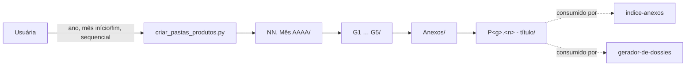

# Criador de Pastas de Produtos

> **Summary in English.** Small interactive Python script that creates the monthly folder tree used to collect the
> deliverables of an infrastructure-management program: one folder per month (`07. Janeiro 2026`), five work groups
> (`G1`–`G5`), an `Anexos` folder per group and one subfolder per product (`P1.1 - ...`). It is the first link of a
> chain of small automations (index of annexes, monthly dossier) that all rely on this exact structure. Built by
> Emmily Maciel; this public copy is sanitized and uses fictitious product titles.

## Problema

Todo mês a equipe precisava da mesma estrutura de pastas para receber os entregáveis de cinco grupos de trabalho.
Criar ~45 pastas à mão por mês gerava nomes inconsistentes ("P1.1-", "P 1.1 ", "Produto 1.1"), e as automações
seguintes (índice de anexos, dossiê) dependem de nomes previsíveis para classificar os arquivos.

## Solução

Um script de terminal que pergunta ano, mês inicial, mês final e o número sequencial da primeira pasta, e cria de uma
vez a árvore completa de cada mês do intervalo — idempotente (`exist_ok=True`), então rodar de novo não estraga nada.

## Arquitetura



## Números

| Indicador | Valor | Fonte |
|---|---|---|
| Código | ~100 linhas, só biblioteca padrão | código |
| Pastas criadas por mês | 24 (1 mês + 5 grupos + 5 `Anexos` + 13 produtos, na estrutura pública) | execução de teste com 2 meses = 48 pastas |
| Tempo economizado | `[a confirmar pela autora]` | — |

## Como rodar

```bat
py criar_pastas_produtos.py
```

Por padrão cria em `.\produtos\` (ignorada pelo Git). Para outra pasta: `set PROG_PRODUTOS_DIR=C:\caminho\exemplo\produtos`.

## O que eu decidi × o que a IA gerou

| Eu (Emmily) decidi | Gerado com apoio de IA, sob minha revisão |
|---|---|
| A convenção de nomes `NN. Mês AAAA / Gx / Anexos / Px.y - título`, que as outras automações usam | `[a confirmar pela autora]` — script curto; a divisão não está documentada |
| Numeração sequencial das pastas de mês informada pela usuária (o contrato não começa em janeiro) | |

## Stack

Python 3 (biblioteca padrão).

## Aviso

*Dados fictícios. Versão sanitizada de um sistema em uso real; identificadores do cliente foram substituídos.*
Os títulos de grupos e produtos desta cópia são genéricos.

Autora: **Emmily Maciel** — [github.com/Emmilymaciell](https://github.com/Emmilymaciell)
